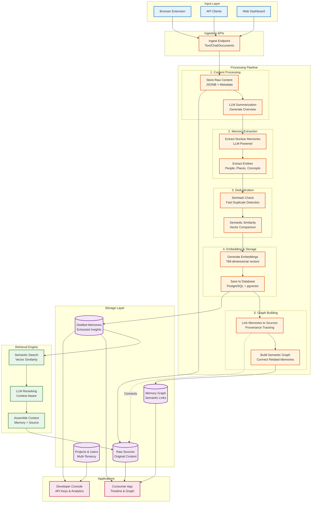

# UniMemory Architecture

## System Overview: Memory Infrastructure

UniMemory is a **multi-layered memory infrastructure** that transforms raw conversational data into semantically-linked, searchable knowledge graphs. It's not just a database—it's an intelligent system that extracts, deduplicates, embeds, classifies, and interconnects memories at scale.

---

## Architecture Diagram

---

## Key Differentiators: Why This is Infrastructure, Not Just a Database

### 1. **Multi-Stage Processing Pipeline**
- **5 distinct processing stages** with specialized algorithms at each layer
- LLM-powered extraction, entity recognition, and fact extraction
- SimHash + semantic deduplication prevents redundancy
- Quality filtering ensures only meaningful memories persist

### 2. **Dual Storage Architecture**
- **Raw Truth Layer** (Sources): Preserves original context, JSONB flexibility
- **Distilled Memory Layer** (Memories): Semantic insights, embedded for search
- **Provenance Tracking**: N:N links maintain full lineage from memory → source

### 3. **Intelligent Graph Construction**
- **Waypoints**: Background jobs build semantic connections between memories
- **Relationship strength scoring**: Not just links, but weighted relevance
- **Graph traversal optimization**: Indexed for fast exploration

### 4. **Advanced Retrieval Engine**
- **Vector search** with pgvector (768-dimensional embeddings)
- **LLM reranking** for contextual relevance beyond cosine similarity
- **RAG-ready context assembly**: Combines memories + raw sources

### 5. **Multi-Tenancy & Isolation**
- **Owner-level separation**: Users, API keys, projects
- **End-user scoping**: Memories tied to end_user_id within owner context
- **Project workspaces**: Logical isolation within accounts

### 6. **Dual Product Architecture**
- **B2B API** (console.unimemory.app): API keys, usage analytics, ingest settings
- **Consumer App** (app.unimemory.app): Timeline, explorer, graph visualization
- **Shared backend engine**: Single source of truth, dual interfaces

---

## Technical Highlights for Faculty Panel

### **Database Technology**
- PostgreSQL with **pgvector extension** for native vector operations
- **768-dimensional embeddings** using OpenAI's text-embedding-3-small
- **Cosine similarity search** with threshold-based filtering (< 0.15 for dedup)

### **LLM Integration**
- **Memory extraction**: Custom prompts for nuclear memory generation
- **Entity & fact extraction**: Structured data from unstructured conversations
- **Summarization**: Contextual overviews for long documents
- **Reranking**: Semantic relevance scoring beyond vector distance

### **Deduplication Algorithm**
- **SimHash**: Locality-sensitive hashing for near-duplicate detection
- **Semantic similarity**: Vector-based comparison for conceptual duplicates
- **Two-tier approach**: Fast hash check → deep semantic check

### **Background Processing**
- **Async waypoint construction**: Non-blocking graph building
- **Batch operations**: Optimized memory-source linking
- **Job scheduling**: Celery/background tasks for heavy lifting

### **API Design**
- **Stable Core API**: `/v1/memories`, `/v1/search`, `/v1/health`
- **Evolvable Ingest API**: `/v1/ingest/*` for LLM-powered processing
- **RESTful patterns**: Predictable, versioned, documented

---

## Data Flow Example: Chat Ingestion

1. **Extension captures** chat messages from Claude/ChatGPT
2. **POST /ingest/chat** with messages array + metadata
3. **Source created** with raw JSONB content + project_id
4. **LLM extracts** 5-10 nuclear memories from conversation
5. **Entities extracted**: People, concepts, tools mentioned
6. **SimHash computed** for each memory (64-bit fingerprint)
7. **Semantic check** against existing memories (cosine < 0.15 = duplicate)
8. **Embeddings generated** for unique memories (768-dim vectors)
9. **Memories stored** in PostgreSQL with user_id, project_id
10. **Memory-Source links** created (N:N relationship)
11. **Waypoint job scheduled** to find semantic connections
12. **Graph updated** with new nodes and edges
13. **Dashboard refreshes** with new memories visible in timeline/graph

---

## Scalability & Performance

- **Vector indexing**: IVFFlat/HNSW for sub-linear search time
- **Batch processing**: Bulk inserts for memory-source links
- **Caching strategy**: No-store for fresh data, strategic caching elsewhere
- **Connection pooling**: Async database connections
- **Background jobs**: Heavy processing off critical path

---

## Future Enhancements

- **Multi-modal memories**: Image, audio, video ingestion
- **Temporal reasoning**: Time-aware memory retrieval
- **Collaborative workspaces**: Shared projects with permissions
- **Advanced analytics**: Memory growth, usage patterns, insights
- **Custom extractors**: User-defined memory extraction rules

---

**This is not a database with connectors—it's a memory infrastructure that understands, deduplicates, connects, and retrieves knowledge at scale.**
