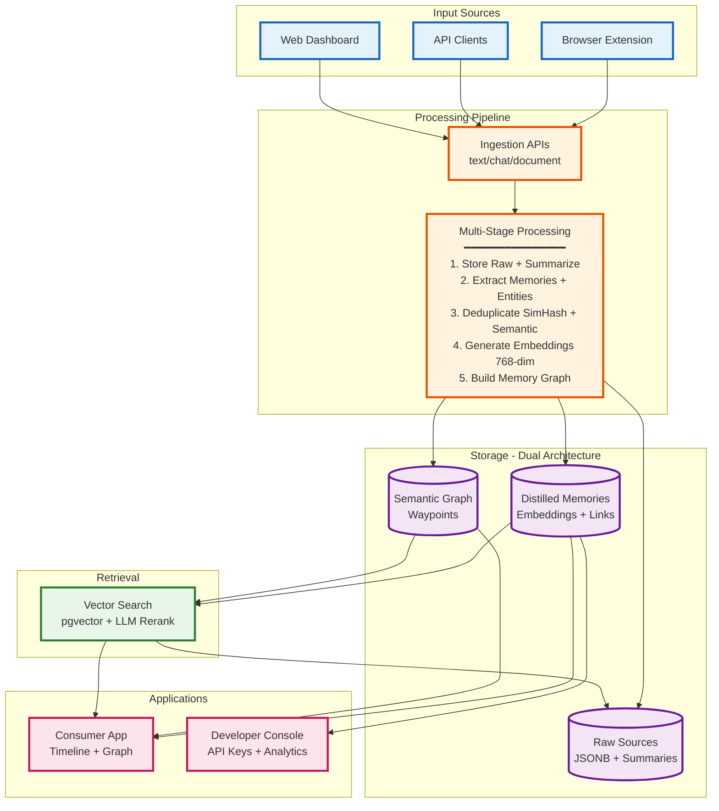
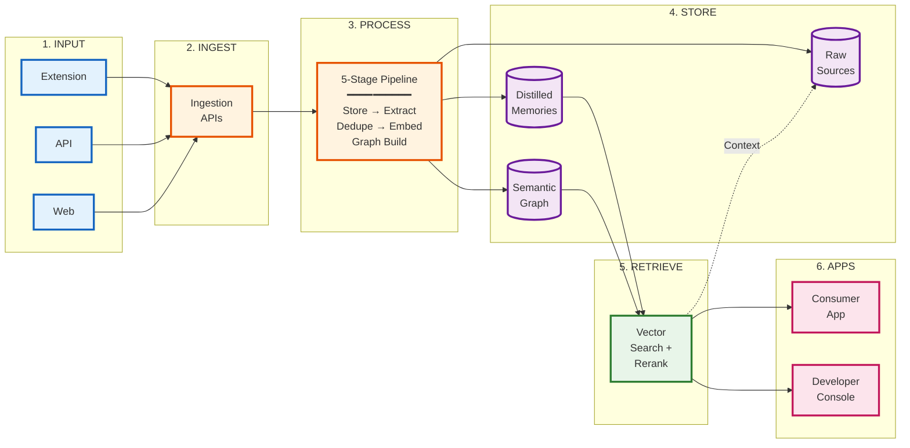

# UniMemory Architecture - PPT Version

## Simplified Architecture for Presentation

---

## Alternative: Horizontal Flow (Better for Wide Slides)

---

## Key Points to Mention During Presentation

### 1. **Not Just a Database**
- 5-stage intelligent processing pipeline
- LLM-powered extraction and summarization
- Dual architecture: Raw truth + Distilled insights

### 2. **Advanced Deduplication**
- SimHash algorithm for fast duplicate detection
- Semantic similarity using vector embeddings
- Prevents redundant memories

### 3. **Semantic Infrastructure**
- 768-dimensional embeddings (text-embedding-3-small)
- PostgreSQL + pgvector for native vector operations
- Graph-based memory connections (Waypoints)

### 4. **Intelligent Retrieval**
- Vector similarity search
- LLM reranking for context-aware results
- RAG-ready: Combines memories + raw sources

### 5. **Dual Product Architecture**
- Consumer app: Timeline, graph visualization
- Developer console: API keys, analytics, usage tracking
- Single backend engine serving both

---

## Talking Points for Each Stage

**Input Layer:**
- "Multiple ingestion points - browser extension for automatic capture, API for B2B integration, web dashboard for manual uploads"

**Processing Pipeline:**
- "5-stage intelligent pipeline - not just storing data, but understanding it"
- "LLM extracts nuclear memories, entities, and facts"
- "Deduplication using SimHash + semantic similarity prevents redundancy"
- "768-dimensional embeddings enable semantic search"
- "Background jobs build semantic graph connecting related memories"

**Storage Layer:**
- "Dual architecture - raw sources preserve original context, distilled memories store extracted insights"
- "Semantic graph (Waypoints) connects related memories across conversations"
- "Multi-tenancy with project isolation"

**Retrieval Engine:**
- "Vector search using pgvector - native PostgreSQL extension"
- "LLM reranking for context-aware relevance"
- "Assembles full context by linking memories back to raw sources"

**Applications:**
- "Two products from one engine - consumer app for end users, developer console for B2B clients"
- "Timeline view, graph visualization, semantic exploration"

---

## One-Liner Summary

**"UniMemory is a multi-layered memory infrastructure that transforms raw conversations into semantically-linked, searchable knowledge graphs using LLM-powered extraction, vector embeddings, and intelligent deduplication."**
