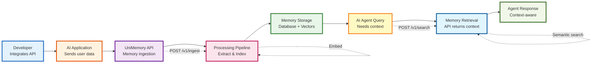

# UniMemory Workflow Diagrams

## Two Products, One Infrastructure

---

## 1️⃣ Consumer Workflow (D2C - End Users)

**Use Case:** Personal memory layer for AI tools

```mermaid
graph LR
    A[User<br/>Interacts with AI] --> B[Extensions & MCPs<br/>Capture conversations]
    B --> C[UniMemory Backend<br/>Process & Store]
    C --> D[User asks query<br/>in AI tool]
    D --> E[Memory Retrieval<br/>Find relevant context]
    E --> F[AI Response<br/>Context-aware answer]
    
    C -.1. Store raw source.-> C
    C -.2. Extract memories.-> C
    C -.3. Index vectors.-> C
    
    E -.Search & inject.-> F
    
    style A fill:#e3f2fd,stroke:#1565c0,stroke-width:3px
    style B fill:#fff3e0,stroke:#e65100,stroke-width:3px
    style C fill:#f3e5f5,stroke:#6a1b9a,stroke-width:3px
    style D fill:#e8f5e9,stroke:#2e7d32,stroke-width:3px
    style E fill:#fce4ec,stroke:#c2185b,stroke-width:3px
    style F fill:#e1f5fe,stroke:#01579b,stroke-width:3px
```

### Flow Explanation:

1. **User Interacts with AI**
   - ChatGPT, Claude, Cursor, Windsurf

2. **Extensions & MCPs Capture**
   - Browser extension captures conversations
   - MCP connectors integrate with AI tools
   - Send data to UniMemory backend

3. **UniMemory Backend Processing**
   - Stores raw conversations as sources
   - Extracts nuclear memories using LLM
   - Generates embeddings (768-dim vectors)
   - Indexes in vector database

4. **User Asks New Query**
   - User continues conversation in AI tool

5. **Memory Retrieval**
   - System searches past memories
   - Finds relevant context using vector search
   - Injects memory into AI tool

6. **AI Response**
   - AI generates context-aware response
   - Uses retrieved memory for personalization

---

## 2️⃣ Developer API Workflow (B2B - AI Applications)

**Use Case:** Memory infrastructure for AI agents and applications



### Flow Explanation:

1. **Developer Integrates API**
   - Gets API key from console.unimemory.app
   - Integrates UniMemory SDK/API into application

2. **AI Application Sends Data**
   - User interactions, logs, knowledge data
   - Sent via REST API endpoints

3. **UniMemory API Ingestion**
   - `POST /v1/ingest/text` - Plain text
   - `POST /v1/ingest/chat` - Conversations
   - `POST /v1/ingest/document` - Files

4. **Processing Pipeline**
   - Summarization using LLM
   - Memory extraction (nuclear memories)
   - Entity and fact extraction
   - Embedding generation
   - Deduplication (SimHash + semantic)

5. **Memory Storage**
   - PostgreSQL + pgvector database
   - Raw sources + distilled memories
   - Semantic graph (waypoints)

6. **AI Agent Query**
   - Agent needs context for user request
   - Calls UniMemory search API

7. **Memory Retrieval**
   - `POST /v1/search` with semantic query
   - Vector similarity search
   - LLM reranking for relevance
   - Returns top-k memories with sources

8. **Agent Response**
   - Agent uses retrieved context
   - Generates personalized, context-aware response
   - Maintains conversation continuity

---

## Simplified Side-by-Side Comparison

| **Consumer (D2C)** | **Developer (B2B)** |
|-------------------|-------------------|
| Browser extensions & MCPs | REST API integration |
| Automatic capture | Manual data ingestion |
| Personal memory layer | Memory infrastructure |
| app.unimemory.app | console.unimemory.app |
| Timeline & graph UI | API keys & analytics |
| Free tier | Usage-based pricing |

---

## Key Presentation Points

### Why Two Workflows Matter:

✅ **Shows platform scope** - Not just a browser extension  
✅ **Dual product architecture** - Consumer + Developer  
✅ **Same backend engine** - Shared infrastructure  
✅ **Multiple use cases** - Personal AI + AI agents  
✅ **Justifies team size** - Enough work for 4 students

### What to Say:

> "UniMemory serves two distinct markets with the same memory infrastructure. For consumers, we provide extensions and MCPs that automatically capture and inject memory into AI tools. For developers, we offer APIs that give their AI applications persistent memory capabilities. Both workflows use the same backend processing pipeline, storage layer, and retrieval engine."

---

## Alternative: Horizontal Chevron Style (Like Your Current PPT)

### Consumer Flow (Chevron Style)

```
┌──────────┐    ┌────────────────┐    ┌──────────────┐    ┌──────────────┐    ┌──────────────┐
│   User   │ ──>│ Extensions &   │ ──>│  UniMemory   │ ──>│ User asks    │ ──>│ AI responds  │
│          │    │     MCPs       │    │   Backend    │    │    query     │    │ with context │
└──────────┘    └────────────────┘    └──────────────┘    └──────────────┘    └──────────────┘
                                              │                    │
                                              ↓                    ↓
                                      • Store raw data      • Search memories
                                      • Extract memories    • Inject context
                                      • Index vectors       • Personalize
```

### Developer Flow (Chevron Style)

```
┌──────────┐    ┌────────────────┐    ┌──────────────┐    ┌──────────────┐    ┌──────────────┐
│Developer │ ──>│      AI        │ ──>│  UniMemory   │ ──>│  AI Agent    │ ──>│    Agent     │
│Integrates│    │  Application   │    │     API      │    │   queries    │    │  responds    │
└──────────┘    └────────────────┘    └──────────────┘    └──────────────┘    └──────────────┘
                                              │                    │
                                              ↓                    ↓
                                      • POST /ingest        • POST /search
                                      • Process pipeline    • Vector search
                                      • Store memories      • Return context
```

---

## For PowerPoint: Use This Text Layout

### Slide 1: Consumer Workflow

**Title:** Consumer Workflow - Personal Memory Layer

**Flow:**
```
User → Extensions/MCPs → UniMemory Backend → Query → AI Response
```

**Details:**
- Extensions capture conversations automatically
- Backend extracts memories and indexes them
- When user asks new questions, relevant memories are injected
- AI provides context-aware, personalized responses

---

### Slide 2: Developer Workflow

**Title:** Developer API Workflow - Memory Infrastructure

**Flow:**
```
Developer → AI App → UniMemory API → Processing → Storage → Retrieval → Agent
```

**Details:**
- Developers integrate via REST API
- Applications send user data for memory storage
- UniMemory processes and indexes memories
- AI agents retrieve context via search API
- Agents generate context-aware responses

---

## 🎯 Final Recommendation

Use the **Mermaid diagrams** for clean presentation. They're:
- ✅ Professional looking
- ✅ Color-coded for clarity
- ✅ Easy to explain
- ✅ Show technical depth

Keep the **chevron style** as backup if the panel prefers the format you already have.
